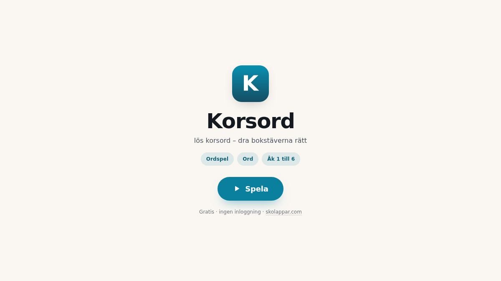

# Korsord

Korsord på svenska för åk 1 till 6. Barnet löser korsord med emoji-bilder och ledtrådar – de
yngsta drar hela ord till rätt rad, de lite äldre lägger bokstäver och de äldsta skriver som i ett
vanligt korsord.

**Spela:** https://korsord.skolappar.com · En del av [Skolappar](https://www.skolappar.com) – pedagogiska appar av föräldrar · öppen källkod (MIT)



Började som ett Google AI Studio-projekt och körs nu fristående. Korsorden byggdes först av
Gemini; nu skapas de lokalt från en egen ordbank.

## Vad du kan göra

- **Fyra åldersnivåer** med olika spelsätt:
  - 6–8 år (Nybörjare, tema Djur): dra hela ord.
  - 8–10 år (Upptäckare, tema Skolan): lägg bokstäver.
  - 10–12 år (Expert, tema Rymden) och 12+ (Mästare, tema Historia): skriv in bokstäverna.
- **Tre svårighetsgrader** – Lätt, Medel och Svår – som styr hur många ord rutnätet får.
- **Ett nytt korsord varje gång**: orden slumpas ur ordbanken och flätas ihop till ett rutnät.
- **Fungerar på iPad**: tryck på ett ord och sedan på rutan där det ska ligga.
- **Ledtrådar** för 10 mynt: fyller i ett ord eller nästa saknade bokstav.
- **XP och mynt** för varje löst korsord (mer på svårare nivå).
- **Fortsätt där du slutade**: ett påbörjat korsord sparas.

## Kom igång

```bash
npm install
npm run dev      # utvecklingsserver på port 3000
npm run build    # produktionsbygge till dist/
npm run preview  # förhandsgranska bygget
```

Docker-bygget använder Node 22.

## Docker

```bash
docker build -t korsord .
docker run --rm -p 8080:8080 korsord
```

Servern ligger bakom nginx med `deploy/nginx.conf`.

## Integritet

- Ingen inloggning, inga kakor, ingen analys, inga AI-tjänster.
- Inga anrop till externa servrar. Orden ligger i `data/wordBank.ts`, bilderna är emojis och
  typsnittet Fredoka ligger i `public/fonts/`.
- XP, mynt och klarade korsord sparas i `localStorage` under `korsord_progress`, ett påbörjat
  korsord under `korsord_saved_game`.

## Struktur

```
App.tsx                     menyer, spelsätt, ledtrådar, XP och mynt, sparning
data/wordBank.ts            ordbanken: sju teman med ord, ledtråd och emoji
lib/crossword.ts            bygger rutnätet av orden
services/wordService.ts     väljer tema och antal ord
components/Grid.tsx         rutnätet
components/DraggableWord.tsx ordkort att dra eller trycka på
deploy/nginx.conf           nginx-konfiguration
```

## Licens

MIT – se [LICENSE](LICENSE).
